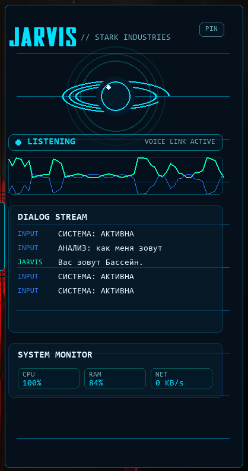
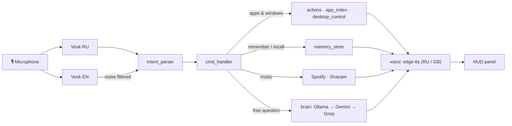

<div align="center">

# J.A.R.V.I.S.

**A voice-controlled AI assistant for Windows, inspired by Iron Man.**

Speak to your PC in Russian or English: it opens apps, controls windows, types for you,
finds music, remembers facts about you and answers questions with a local LLM.

[](https://github.com/lortdraver/jarvis-ai/actions/workflows/tests.yml)


-00D2FF)




</div>

## Highlights

- 🎙️ **Offline speech recognition** — two [Vosk](https://alphacephei.com/vosk/) models (RU + EN) run in parallel; no audio ever leaves your PC
- 🧠 **Free LLM brain with fallback** — local [Ollama](https://ollama.com) (`qwen3:8b`) first, Google Gemini as a backup, Groq optional
- 🗣️ **Two voices** — Russian replies in a Russian neural voice, English replies in a calm British voice; offline Windows voice as a fallback
- 🪟 **Real PC control** — open/close any installed app, switch and close windows, copy/paste/save/undo, screenshots, type dictated text
- 🎵 **Music** — play tracks via Spotify, recognise what's playing via Shazam
- 💾 **Memory** — “remember my name is …”, “what do you remember?”, “forget …”
- 🛡️ **Safety first** — shutdown requires a spoken confirmation; dangerous or unclear commands ask before acting
- 💠 **HUD panel** — slide-out, always-on-top panel with live voice waveform, dialog stream and CPU/RAM/network monitor

## How it works



| Module | Responsibility |
|---|---|
| `main.py` | Microphone stream, two Vosk recognisers, English-noise filter |
| `intent_parser.py` | Turns a phrase into an intent (pure Python, unit-tested) |
| `cmd_handler.py` | Executes intents, confirmations, sleep mode |
| `actions.py` · `app_index.py` | Finds apps by Start-menu shortcuts and `.exe`, opens / closes them |
| `desktop_control.py` | Hotkeys and window management |
| `memory_store.py` | Simple long-term memory in `data/memory.json` |
| `brain.py` | LLM with provider fallback, date/time and memory in the context |
| `voice.py` | Text-to-speech with automatic RU / EN voice selection |
| `ui_orb.py` | The HUD panel (Pygame + Win32) |

## Quick start

**Requirements:** Windows 10/11 · Python 3.10+ · a microphone · optionally [Ollama](https://ollama.com/download)

```powershell
git clone https://github.com/lortdraver/jarvis-ai.git
cd jarvis-ai
python -m venv .venv
.\.venv\Scripts\Activate.ps1
pip install -r requirements.txt

python scripts/download_models.py   # offline speech models, ~90 MB
ollama pull qwen3:8b                # free local LLM (optional but recommended)
copy .env.example .env              # add a free Gemini key as a backup brain

python main.py
```

Try the voices first: `python voice_test.py`.

## Voice commands

| Say | Result |
|---|---|
| «Джарвис, открой хром» / “Jarvis, open Spotify” | Opens the app |
| «Джарвис, закрой блокнот» | Closes the app |
| «Джарвис, напиши привет» | Types text into the active window |
| «Джарвис, сверни все окна» · «переключи окно» | Window control |
| «Джарвис, скопируй / вставь / сохрани» | Hotkeys |
| «Джарвис, сделай скриншот» | Saves a screenshot |
| «Джарвис, включи песню Back in Black» | Plays it on Spotify |
| «Джарвис, что за песня?» | Recognises the music playing |
| «Джарвис, запомни: меня зовут Гусейн» · «что ты помнишь?» | Memory |
| «Джарвис, выключи компьютер» → «подтверди» | Shuts down after confirmation |
| «Джарвис, …» anything else | Answer from the LLM |

## Configuration

Everything lives in `.env` (see [`.env.example`](.env.example)):

| Variable | Default | Meaning |
|---|---|---|
| `JARVIS_AI_PROVIDERS` | `ollama,gemini` | Order in which LLMs are tried |
| `OLLAMA_MODEL` | `qwen3:8b` | Local model |
| `GEMINI_API_KEY` | — | Free key from [Google AI Studio](https://aistudio.google.com/apikey) |
| `JARVIS_LANG` | `ru` | `en` makes Jarvis answer in English with the British voice |
| `JARVIS_VOICE_RU` / `JARVIS_VOICE_EN` | Dmitry / Ryan | Voices for each language |

## Tests

```powershell
pip install pytest
pytest
```

The parser, memory, safety confirmations and LLM fallback chain are covered by tests that run on every push.

## Roadmap

- [ ] Multi-step agent mode (“open Telegram and write to Anna …”)
- [ ] Custom wake word without the full RU model
- [ ] Fully offline neural voice (Piper)
- [ ] One-click `.exe` installer

## Author

**Huseyn** · Robotics & Artificial Intelligence student at the University of Klagenfurt, Austria
[GitHub](https://github.com/lortdraver) · [LinkedIn](https://www.linkedin.com/in/huseyn-aliyev-978203385)

*Jarvis, Iron Man and Stark Industries are trademarks of Marvel. This is an independent fan project, not affiliated with Marvel.*

## License

[MIT](LICENSE)
